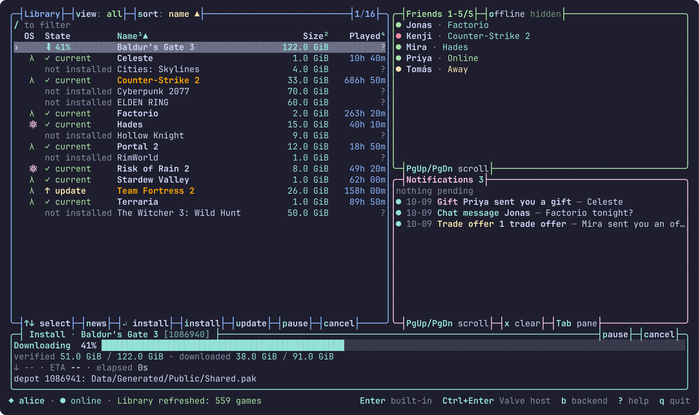
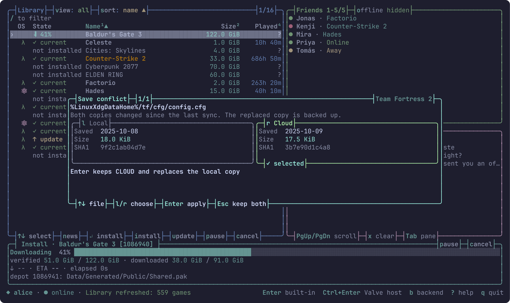

# steam-tui

Lightweight, fast TUI Steam client for Linux (built for Omarchy). Browse, install, update and launch your library without the Steam client or its browser processes.

Early state: some games won't work without original steam client.



- Starts in ~2 ms and uses ~30 MB of memory.
- Install and update games (native and Proton), with pause and resume.
- Friends, live notifications, game changelogs.
- Steam Cloud saves, with a side-by-side local/cloud conflict picker.
- Games run on our own Steam backend, so no Steam process is needed.



## Installation

Built for Omarchy (Arch, x86_64). Windows games need Proton, and a Secret Service keyring (GNOME Keyring or KWallet) stores your login.

**Prebuilt (fastest):**

```sh
curl -L https://github.com/vanyapoker/steam-tui/releases/latest/download/steam-tui-x86_64-linux.tar.gz | tar -xz -C ~/.local
steam-tui login --account YOUR_STEAM_NAME   # first run only
steam-tui
```

Make sure `~/.local/bin` is in your `PATH`.

**From source** (needs Rust, CMake, make, Perl and a C++ compiler; the first build takes a few minutes):

```sh
git clone https://github.com/vanyapoker/steam-tui && cd steam-tui
./install.sh
```

`install.sh` installs to `~/.local` without sudo. Use `PREFIX=/some/path ./install.sh` to change that.

## Hotkeys

Press `?` in the app for the full list.

| Key | Action |
| --- | --- |
| Enter / double-click | Launch the game |
| Ctrl+Enter | Launch through Valve's Steam client |
| i / u | Install / update |
| p / c | Pause / cancel the download |
| C | Steam Cloud sync |
| n / right-click | Changelog |
| / | Filter |
| f | Pin a game |
| v | All / installed / not installed |
| 1-4, s, S | Sort by column, cycle sort, reverse |
| Tab | Switch pane |
| r | Refresh |
| b | Backend traffic |
| q | Quit |

## Steamworks coverage

| Works | Partial | Not yet |
| --- | --- | --- |
| User, Utils, Apps, Friends (basics) | Matchmaking and lobbies | Stats and achievements |
| Game Coordinator relay | Networking sockets, P2P and relay | Workshop, Inventory |
| Steam Cloud | Auth tickets | Input, Screenshots |

Unsupported calls log and abort rather than pretend to work.

## Limitations

- VAC-secured games run through Valve's Steam client without its web helpers. It must be signed in to the same account, and costs about 200 MB extra. Enter picks this automatically.
- Online matchmaking and relay networking are unfinished.
- Linux only.

## Not implemented yet

Chat, game invites, achievements, Workshop, store and community pages, trading.

## License

[MIT](LICENSE). Vendored and third-party code keeps its own license, see [THIRD_PARTY.md](THIRD_PARTY.md).


> Not affiliated with or endorsed by Valve; Steam and VAC are Valve trademarks. steam-tui signs in to your real Steam account through its own client, which Valve's terms may not allow. Use it at your own risk.
