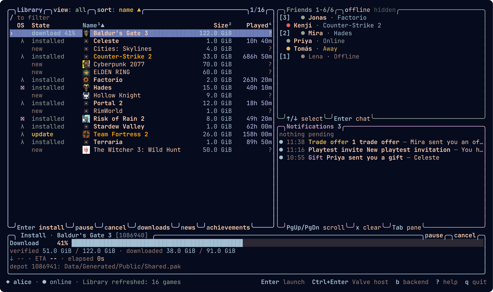
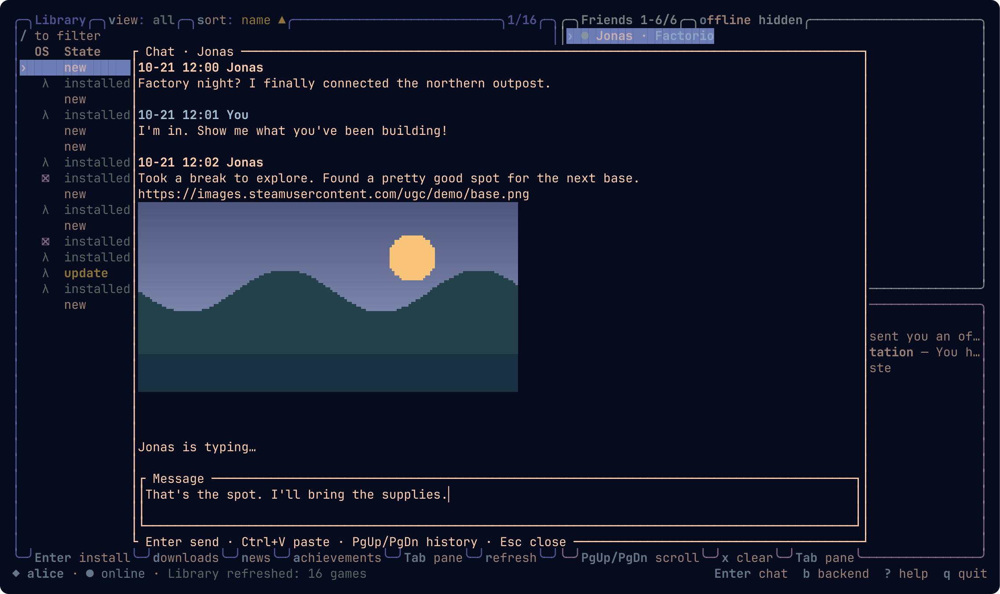
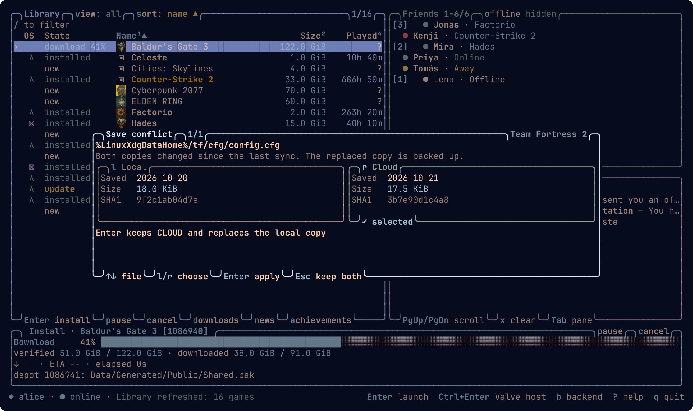

# steam-tui

Lightweight, fast TUI Steam client for Linux (built for Omarchy). Browse, install, update and launch your library without the Steam client or its browser processes.

Early state: some games still need Valve's Steam client. VAC-secured games automatically use the headless Valve host.



*Demo screens use fictional accounts, friends, and messages.*

- Starts in ~2 ms and uses ~30 MB of memory.
- Install and update games (native and Proton), with verified resumable downloads, crash recovery, a persistent queue, pause/resume, priorities and download windows.
- Check for updates before launch, with an explicit option to launch the installed version.
- Select branches, languages and optional DLC; protected branch keys stay in the keyring.
- Vulkan shader pre-caching enabled by default, with automatic refreshes of downloaded caches, processing before launch, and a skip control.
- Missing Proton and runtime dependencies install automatically before launch.
- Proton games get Valve's transcoded video/audio databases (when the app has them) and persistent per-game GPU caches.
- Shared redistributables install per library; verified Windows prerequisites run in the Proton prefix and supported Linux setup actions run in the game tree.
- DLC enumeration, ownership, installed state, downloads, and optional removal through the game's Steamworks APIs.
- Game icons in the library, friends, direct-message chat with unread badges, recent and live notifications, game changelogs.
- Steam Cloud downloads before launch, manual two-way sync, and a side-by-side conflict picker with backups of replaced saves.
- Achievement browsing with unlock dates, global rarity, sorting and filters; in-game stats, achievements and leaderboards through the built-in backend.
- Workshop queries, subscriptions, verified downloads, votes and favorites through supported games' Steamworks calls.
- Xbox-compatible, DualSense and DualShock 4 controllers forwarded through a virtual Xbox 360 pad, with rumble and reconnection support.
- Offline browsing of installed games, remembered pins and view settings, multiple saved accounts, and automatic connection recovery.
- Games run on our own Steam backend, so no Steam process is needed.

## Chat

Select a friend with ↑ / ↓ and press Enter. Read and send messages, preview shared
images, and paste an image with Ctrl+V to attach it. Unread badges keep new messages
visible in the friends list.



<details>
<summary>Steam Cloud save conflict picker</summary>



</details>

## Installation

Built for Omarchy (Arch, x86_64). Windows games need Proton, and a Secret Service keyring (GNOME Keyring or KWallet) stores your login.

**Prebuilt (fastest):**

```sh
curl -L https://github.com/vanyapoker/steam-tui/releases/latest/download/steam-tui-x86_64-linux.tar.gz | tar -xz -C ~/.local
steam-tui login --account YOUR_STEAM_NAME   # first run only
steam-tui
```

Make sure `~/.local/bin` is in your `PATH`.

**From source** (needs Rust, Git, Python 3, CMake, make, Perl and a C++ compiler; the first build takes a few minutes):

```sh
git clone https://github.com/vanyapoker/steam-tui && cd steam-tui
./install.sh
```

`install.sh` installs to `~/.local` without sudo. Use `PREFIX=/some/path ./install.sh` to change that. It builds and packages a pinned standalone `fossilize-replay`; no Steam installation or Vulkan capture layer is needed for shader processing. Vulkan drivers are needed at runtime. For development builds, set `STEAM_TUI_FOSSILIZE_REPLAY` to your standalone helper or place it beside the executable.

## Hotkeys

Press `?` in the app for the full list.

| Key | Action |
| --- | --- |
| Enter / double-click | In the library: launch (checks for an update first); install when not installed |
| ↑ / ↓, Enter | In Friends: select a friend and open chat |
| Ctrl+Enter | Launch through Valve's Steam client |
| l | Launch the installed version without updating |
| u | Update |
| p / c | Pause / cancel the download; `c` also skips shader processing while launching |
| m | Manage content: branch, language, DLC |
| d | Downloads: the persistent content/shader queue |
| o | Cycle the selected game's launch option (e.g. DirectX 11 / 12) |
| z | Queue a Vulkan shader pre-cache download or refresh for the selected game |
| y | Sync Steam Cloud saves |
| n / right-click | Changelog |
| a | Achievements of the selected game (1-4 / s sort, f filter, r reload) |
| / | Filter |
| f | Pin a game |
| v | All / installed / not installed |
| 1-4, s | Sort by column (the active column again reverses), cycle sort |
| Tab / Shift+Tab | Switch between Library and Friends; arrows and Home/End follow focus |
| PgUp / PgDn | Scroll Notifications from either main pane |
| o / x | In Friends: show offline friends. In either main pane: clear Notifications |
| r | Refresh |
| b | Backend traffic |
| q | Quit (closes an overlay instead while one is open) |

Library rows show each game's Steam app icon beside its name. Icons load only
for visible games, reuse existing local artwork when available, and are cached
under `~/.cache/steam-tui/icons` (or `$XDG_CACHE_HOME/steam-tui/icons`). Offline mode
uses local icons only. Native terminal graphics give sharp icons; other terminals
use colored blocks. Icons disappear on narrow layouts to leave names readable.

Notifications load all visible history retained by Steam, including read entries,
then update live. The feed is sorted newest first; `○` marks unread entries and
`●` marks live arrivals since the feed was last paged. Page Up/Down scrolls
Notifications from either Library or Friends, without moving their selection;
`x` clears the feed. Clearing only affects this session. `steam-tui notifications` prints the same account history without opening
the TUI; `--account NAME` selects a different saved account.

Tab to Friends, select with arrows (or `j`/`k`), and press Enter to chat.
Steam-hosted image links get inline previews using the terminal's image protocol,
with colored half-blocks as a fallback. Previews load in the background and stay
in a bounded memory cache; GIF and animated WebP previews show a still frame.
Ctrl+V reads an image or text from the desktop clipboard (`wl-paste` on Wayland,
`xclip` on X11). Images stay as local attachments until Enter uploads and sends
them through Steam; Ctrl+Delete removes an attachment. Existing text drafts are
kept after image sending. Images are normalized to PNG, up to 4096×4096 pixels
and 30 MiB, and failed or uncertain sends retain the attachment for review.
Each friend's badge shows unread messages; offline friends with unread messages
remain visible. Chat loads account history and receives messages live through our
own Steam connection. Enter sends, Shift+Enter inserts a newline, PgUp/PgDn browse
history (PgUp also loads older messages), and Esc closes chat. Drafts survive
closing the modal and failed sends; sends with uncertain delivery are never
retried automatically. In chat, `q` is text. Drafts and loaded messages stay in
memory for this TUI session.

Other overlays close with `Esc`, `q` or the key that opened them, and share `↑↓`/`jk`, `PgUp`/`PgDn` and `Home`/`End`.

## Library, saves and controllers

Pins, sorting, the library view and offline-friend visibility are remembered between sessions. Start with `steam-tui tui --offline` to browse installed games without connecting. Cached catalog rows also appear during online startup while fresh account metadata loads. `--account NAME` selects a saved account; login tokens stay in the Secret Service keyring. Online sessions reconnect when the Steam connection drops.

Press `a` to browse a game's achievements, including descriptions, unlock dates and global rarity, with sorting and unlocked/locked filters. Press `n` or right-click a library row to read the game's changelog, with formatted text and inline images. Click a changelog link to open it in your default browser. The `b` overlay shows backend traffic for diagnosing game compatibility.

Before a TUI launch, Steam Cloud downloads current saves when a connection is available. Press `y` for a two-way sync, including uploading local changes; close the game first. Conflicts open the local/cloud comparison shown above, and the replaced copy is backed up.

Controller forwarding needs write access to `/dev/uinput`. Supported pads appear to games as one virtual Xbox 360 controller, with rumble forwarded back and reconnection after a Bluetooth drop. Steam Input device presence is supported; action sets, remapping, gyro and touchpad forwarding remain unimplemented.

## Updates and shader caches

Press `d` for Downloads: current jobs appear above grouped history. Use `f` to filter by type, Left/Right to browse runs, `[` / `]` to lower/raise app priority, and `{` / `}` to scroll details. The selected job offers pause/resume (`p`), retry (`r`) or cancel (`c`) when applicable; `a` cycles its app’s update policy. New runs show local finish dates; older undated jobs remain unknown.

The queue runs while the TUI is open or `jobs run` is active. Closing it retains pending work; there is no background daemon. Background work pauses during games by default. Explicit foreground content downloads can override that pause. Normal launch checks fresh game metadata; an unavailable check requires the explicit installed-version choice.

```sh
steam-tui jobs list
steam-tui jobs run
steam-tui updates policy APPID automatic  # or launch-only / manual
steam-tui updates window 23:00 06:00
steam-tui content show APPID
steam-tui content launch-option APPID [INDEX|default]   # list or choose a launch entry (TUI: o)
steam-tui content unlock APPID BRANCH    # hidden password prompt; remembers returned key
steam-tui shaders add APPID              # queue a download or refresh (TUI: z); then jobs run
steam-tui shaders show APPID
steam-tui shaders enabled off            # disable Vulkan pre-cache downloads and replay
steam-tui shaders clear APPID            # reclaim this game's generated cache
```

Installs verify every chunk as it is downloaded or resumed and check each staged file's size before committing, as Valve's client does. Set `STEAM_TUI_FULL_VERIFY=1` to also hash every file end to end before commit.

Vulkan shader pre-caching is enabled by default. When the TUI refreshes the library, installed games with an existing downloaded pre-cache are automatically queued for a freshness check once their last check is at least an hour old. These jobs follow the queue's update policy, download window and pause-during-games setting. Press `z` or run `shaders add APPID` to queue an initial download or request a refresh manually. Available caches are processed automatically before launch; processing can be skipped with `c` in the TUI or Ctrl+C during CLI launch/processing. `steam-tui shaders enabled off` disables Vulkan pre-cache downloads and processing for the selected account.

Proton video/audio databases are downloaded or refreshed automatically at launch on the built-in backend when Steam provides them for the game. They use the same Steam bucket service and live under `steamapps/shadercache/<app>`, but are separate from Vulkan pre-caches: `z` is not required, and `shaders enabled off` does not disable these media downloads. Existing verified databases are reused. Per-game DXVK, Mesa and NVIDIA caches also persist between launches.

Vulkan FOZ v6 archives have their own freshness checks and verified staging. Compilation uses two threads, low CPU priority and a 2 GiB address-space limit per helper process. Failed or skipped processing never marks a context complete and never prevents launching the game. Shader archives have an 8 GiB account budget including staging, adjustable with `shaders budget MIB`; old generations and unused replay contexts are pruned. The budget excludes driver-created cache data and Proton media databases. Vulkan pre-cache state lives under `$XDG_STATE_HOME/steam-tui/updates-ACCOUNT` (`~/.local/state` by default).

See [the update audit](docs/steam-update-gap-audit.md) for evidence, supported formats and validation limits.

## Steamworks coverage

| Works | Partial | Not yet |
| --- | --- | --- |
| User, Utils, Apps, Friends (friend list, personas, rich presence) | Server browser | Publishing Workshop items |
| Lobbies: lists, data, create, join | Networking sockets to hosted servers | Inventory |
| Game Coordinator relay; P2P over Steam relays | Auth tickets, controller presence | Steam Input actions/remapping, Screenshots |
| Steam Cloud, encrypted app tickets | Global stats | Friend avatars, game invites |
| Stats, achievements (with icons), leaderboards | | |
| Workshop: queries, subscriptions, downloads, votes, favorites | | |

Interface versions from SDK 0.99 to 1.65 are served, laid out from Valve's SDK headers: SteamClient 006-021 and 023 (not 022), and every version Valve's public headers ever shipped for User, Utils, Apps, Friends, Matchmaking, Servers, UserStats, Networking, RemoteStorage, Screenshots, HTTP, HTMLSurface, Controller, Inventory, UGC and Input. Where an old version's call has no matching implementation, the slot logs and returns zero. Stats, achievements and leaderboard scores are read from and written to your real Steam account, like the normal client. Workshop items you subscribe to are downloaded in the background into the game's library (`steamapps/workshop/content/<app>/<item>`, recorded in Valve's `appworkshop_<app>.acf`) while the game runs; subscribing, voting, favoriting and the other Workshop calls act on your real account. Publishing items (CreateItem, SubmitItemUpdate) is not supported and reports failure, and so are the voted-on user lists. Unsupported calls log and abort rather than pretend to work.

## Limitations

- VAC-secured games run through Valve's Steam client without its web helpers. It must be signed in to the same account, and costs about 200 MB extra. Enter picks this automatically.
- Lobby play over Steam's relays works with players on Valve's client (verified with Mycopunk). Server browsing and relayed connections to hosted dedicated servers are unfinished.
- In-game DLC changes preserve the parent build; a parent update or ambiguous metadata requires closing/updating the game. Removal retains modified files and user configuration. Windows setup scripts run at the next launch. `SetDlcContext` usage reporting is unavailable.
- Shader download/replay currently covers Vulkan FOZ v6. Legacy GPU-specific shader binary caches and shader capture/upload are not implemented. Real-driver replay performance has not been measured.
- Controllers: Xbox-compatible pads, DualSense and DualShock 4 are mirrored onto one virtual Xbox 360 pad (needs write access to `/dev/uinput`; set `STEAM_TUI_NO_VIRTUAL_GAMEPAD=1` to disable), and Steam Input reports that pad as connected; see [the virtual gamepad notes](docs/virtual-gamepad.md). Remapping, action sets, gyro and touchpad are not implemented, and other pad families or a second pad are left to Wine.
- Linux only.

## Known issues

### Proton game runs but never opens a window

The game shows as running, the process exists, yet no window ever appears and Unity/Unreal write no log. Wine cannot reach the X server, so it waits forever instead of failing. Check with:

```sh
xrandr --listmonitors        # "Can't open display :0" confirms it
ls -la /tmp/.X11-unix/       # X0 is missing
```

Something outside steam-tui (a `/tmp` cleaner, a script running `rm -rf /tmp/*`, a short-lived X server) deleted the `/tmp/.X11-unix/X0` socket while Xwayland kept running. Every X11/Proton app in the session is affected, not only games started by steam-tui.

Fix: log out and back in, which recreates the socket. Without restarting the session, stop the stuck game and point `:0` back at the socket Xwayland still listens on (Hyprland also binds `X0_`):

```sh
pkill -x Mycopunk.exe; pkill -x wineserver   # use the stuck game's executable name
ln -s X0_ /tmp/.X11-unix/X0
xrandr --listmonitors                        # should list your monitors again
```

The link lasts until the next login. To find what deletes the socket, watch the directory: `sudo auditctl -w /tmp/.X11-unix -p wa -k x11sock`, then `sudo ausearch -k x11sock` after it happens.

## Not implemented yet

Steam Input remapping and action sets, game invites, publishing Workshop items, store and community pages, trading.

## License

[MIT](LICENSE). Vendored and third-party code keeps its own license, see [THIRD_PARTY.md](THIRD_PARTY.md).


> Not affiliated with or endorsed by Valve; Steam and VAC are Valve trademarks. steam-tui signs in to your real Steam account through its own client, which Valve's terms may not allow. Use it at your own risk.
