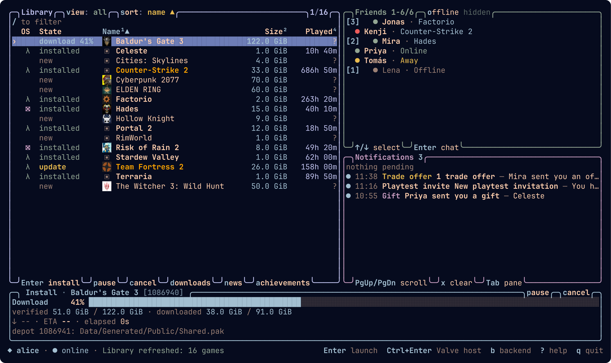

# steam-tui

A fast terminal Steam client for Linux (built for Omarchy). Browse, install, update and launch your library without the Steam client or its browser processes.



*Demo screens use fictional accounts, friends, and messages.*

Starts in ~2 ms and uses ~30 MB of memory. Games run on our own Steam backend, so no Steam process is needed. Early state: VAC-secured games (TF2, CS2, Dota 2, …) automatically use Valve's client in headless mode.

## What it can do

- **Library:** icons, filter, pins, sort, offline browsing, multiple saved accounts.
- **Install and update:** native and Proton games, resumable verified downloads, a persistent queue with pause, priorities and download windows; branches, languages and DLC.
- **Launch:** missing Proton and runtimes install automatically, updates are checked first, Vulkan shaders are pre-cached.
- **Saves:** Steam Cloud download before launch, manual two-way sync, side-by-side conflict picker.
- **Social:** friends list, direct-message chat with images, notifications, game changelogs.
- **In-game features:** achievements, stats, leaderboards, Workshop, lobbies and P2P through the built-in backend.
- **Controllers:** Xbox, DualSense and DualShock 4 as a virtual Xbox 360 pad, with rumble.
- **CLI:** `steam-tui library`, `install`, `jobs`, `updates`, `shaders`, `content` and `notifications` work without opening the TUI.

## Install

Needs Arch/Omarchy (x86_64), Proton for Windows games, and a Secret Service keyring (GNOME Keyring or KWallet) for your login.

```sh
curl -L https://github.com/vanyapoker/steam-tui/releases/latest/download/steam-tui-x86_64-linux.tar.gz | tar -xz -C ~/.local
steam-tui login --account YOUR_STEAM_NAME   # first run only
steam-tui
```

Make sure `~/.local/bin` is in your `PATH`. To build from source (Rust, Git, Python 3, CMake, make, Perl, a C++ compiler):

```sh
git clone https://github.com/vanyapoker/steam-tui && cd steam-tui
./install.sh        # installs to ~/.local; PREFIX=/some/path to change
```

## Keys

Press `?` in the app for the full list.

| Key | Action |
| --- | --- |
| Enter / double-click | Launch (checks for an update first), or install |
| u / l | Update / launch the installed version without updating |
| p / c | Pause / cancel a download |
| m | Manage content: branch, language, DLC |
| d | Downloads queue |
| y | Sync Steam Cloud saves |
| a | Achievements |
| n / right-click | Changelog |
| / , f , v | Filter, pin, all/installed/not installed |
| Tab | Switch Library and Friends (Enter on a friend opens chat) |
| q | Quit or close an overlay |

## Limitations

- VAC-secured games use Valve's Steam client without its web helpers (about 200 MB extra). It must be signed in to the same account.
- Server browsing and relayed connections to hosted dedicated servers are unfinished.
- Not implemented: Steam Input remapping and action sets, game invites, publishing Workshop items, store and community pages, trading.
- Linux only.

## More

[Full guide](usage/guide.md): chat, hotkeys, saves, controllers, updates, shader caches, CLI examples, Steamworks coverage and known issues. See also [docs/](docs/) for design notes.

## License

[MIT](LICENSE). Vendored and third-party code keeps its own license, see [THIRD_PARTY.md](THIRD_PARTY.md).

> Not affiliated with or endorsed by Valve; Steam and VAC are Valve trademarks. steam-tui signs in to your real Steam account through its own client, which Valve's terms may not allow. Use it at your own risk.
